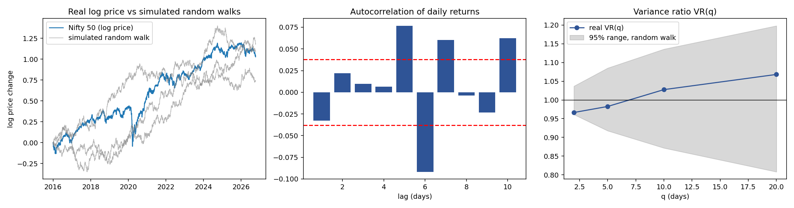

# From Random Walks to Markets

Two small experiments built on Pólya's recurrence theorem:

1. **Simulation (1D–5D):** how likely is a simple random walk to ever return to its starting point, as the dimension grows?
2. **Market test:** how close are daily Nifty 50 prices (2016–2026) to a random walk?

Author: Ketan Vishnoi, B.S. (Data Science), Indian Statistical Institute, Delhi · 

This is a student exploration, not a published result. See *Limitations* below.

## Background

Pólya (1921) proved that the simple random walk on Z^d returns to the origin with probability 1 for d = 1, 2 (recurrent) and with probability u < 1 for d ≥ 3 (transient). If G = Σ P(walk is at the origin at step 2n) is the expected number of visits to the origin, then u = 1 − 1/G. The known exact values are u ≈ 0.3405 (3D), 0.1932 (4D) and 0.1352 (5D).

## 1. Simulation results

`walk_sim.py` simulates N = 10,000 independent walks per dimension for up to 10^5 steps (fixed seeds) and records the fraction that have returned by step T. The standard error is at most about 0.005.

| d | T = 10² | T = 10³ | T = 10⁴ | T = 10⁵ | Exact u |
|---|---|---|---|---|---|
| 1 | 0.920 | 0.977 | 0.993 | 0.998 | 1 |
| 2 | 0.592 | 0.685 | 0.746 | 0.786 | 1 (approached very slowly) |
| 3 | 0.307 | 0.327 | 0.332 | 0.333 | 0.3405 |
| 4 | 0.187 | 0.188 | 0.188 | 0.188 | 0.1932 |
| 5 | 0.133 | 0.134 | 0.134 | 0.134 | 0.1352 |

The 3D–5D estimates agree with the exact values within statistical error. The 2D walk is recurrent but approaches 1 only logarithmically, so a sizeable fraction of walks has not returned even after 10^5 steps. Full numbers are in `walk_sim_results.csv`.

## 2. Is the Nifty 50 a random walk?

`nifty_random_walk_tests.py` loads daily closing prices, computes log returns, and runs:

- autocorrelation at lags 1–10 with the Ljung–Box test,
- the Lo–MacKinlay variance ratio test (robust to changing volatility) for q = 2, 5, 10, 20,
- the Wald–Wolfowitz runs test on up and down days,

and compares variance ratios with simulated Gaussian random walks of the same mean and volatility.

| Measure | 2016–2026 (2,667 returns) | 2016–2019 (985) | 2021–2026 (1,429) |
|---|---|---|---|
| Excess kurtosis | 21.1 | 2.7 | 3.9 |
| Ljung–Box p (10 lags) | < 0.001 | 0.014 | 0.283 |
| Variance ratio p, q = 2–20 | 0.46–0.87 | 0.17–0.73 | 0.45–0.92 |
| Runs test p | < 0.001 | 0.387 | < 0.001 |

The two sub-periods exclude 2020, which contains an extreme crash.



**What it shows**

- The variance ratio test never rejects a random walk: variance grows roughly in proportion to the horizon in every period.
- The very heavy tails of the full sample come mostly from 2020.
- Evidence of return autocorrelation depends on the period.
- In 2021–2026 about 55% of days move in the same direction as the previous day, versus about 50% expected under independence. I have not explained why this appears after 2020 and not before.

## How to reproduce

```bash
pip install -r requirements.txt

# 1. simulation: one dimension per run (3D–5D take a few minutes each)
for d in 1 2 3 4 5; do python walk_sim.py $d; done

# 2. Nifty tests: put the yearly CSV files in ./data, then
python nifty_random_walk_tests.py
# optional sub-period:  python nifty_random_walk_tests.py data . 2021-01-01 2026-12-31
```

**Data.** The NSE price files are not included. Download NIFTY 50 historical data from niftyindices.com (Reports → Historical Data → Equity → NIFTY 50), one year at a time if the site limits the range, and save the files as `data/NIFTY_50_Historical_PR_*.csv`. If a year is missing, the script uses the longest unbroken stretch and prints which one.

## Limitations

- One index, daily data and a handful of tests, so individual p-values should not be over-read.
- No transaction costs are included, and nothing here is a trading claim.
- The Gaussian benchmark ignores volatility clustering, so its variance-ratio range is narrower than reality.
- The post-2020 directional persistence is an observation, not an explanation.

## Acknowledgements

Pólya's theorem was first studied in a Probability II course project with Maharshi and Vansh. The extension in this repository (the 1D–5D simulation and the Nifty 50 analysis) was carried out afterwards. The code and analysis were developed with assistance from Claude (an AI assistant by Anthropic); I take responsibility for the content. Data: NSE Indices.
